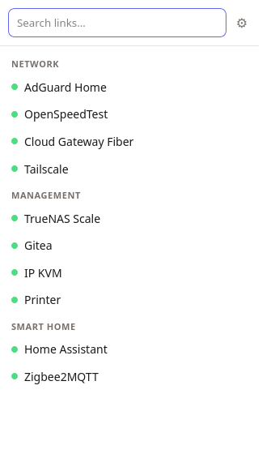
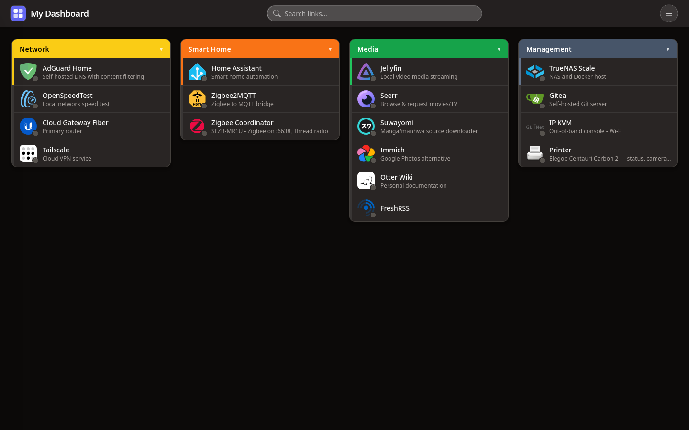

# Tailboard Companion

[](https://github.com/Gren-95/tailboard-companion/actions/workflows/ci.yml)
[](LICENSE)


Browser extension (MV3, Firefox + Chrome) for the self-hosted [Tailboard](https://github.com/Gren-95/tailboard) dashboard.

<p>
  
  
</p>

## Features

- Toolbar popup: searchable list of links grouped by group, with optional status dots. Enter opens the first match; Ctrl/Cmd+click opens in a background tab. The house button opens the dashboard. Shortcut: `Ctrl+Shift+Space`.
- Omnibox: type `tb` + space in the address bar, then a query.
- Right-click menu: links grouped by group, plus an item to open the dashboard.
- Toolbar badge: optional count on the extension icon — down services (red) or up services (green). Off by default.

The extension does not take over the new-tab page. Open the dashboard manually from the popup, the right-click menu, or the omnibox.

Opens each link's resolved `activeUrl` from `/api/status`, so alt-URL fallbacks are respected.

## Setup

Set the instance URL in options (gear icon in the popup). The popup and menus read `GET /api/config` and `GET /api/status` with `credentials: 'include'`, so an instance behind auth works once you are signed in to it in the same browser.

### Options

- **Instance URL** — base URL of your Tailboard instance.
- **Toolbar badge** — none / down (red) / up (green).
- **Refresh interval** — background refresh period in minutes (minimum 1).
- **Open links in** — new tab / current tab / background tab.
- **Popup sort order** — group order / pinned first / A–Z.
- **Theme** — auto / light / dark.
- **Show status dots in the popup** — toggle.
- **Enable right-click menu** — toggle.

## Load

Firefox: `about:debugging` > This Firefox > Load Temporary Add-on > `manifest.json`. A permanent install needs an AMO-signed `.xpi` (`web-ext sign`), or Developer/Nightly/ESR with `xpinstall.signatures.required=false`.

Chrome: `chrome://extensions` > Developer mode > Load unpacked > this folder.

With `web-ext` (`npm i`): `npm run start:firefox`, `npm run build`.

## Notes

- `host_permissions` is `<all_urls>` so any configured instance can be fetched cross-origin. Narrow it to your instance origin if preferred.
- Auth: the dashboard's session cookie is `HttpOnly; SameSite=Strict`. Requests use `credentials: 'include'`, so sign in to the instance in the browser once and the extension rides that session. There is no headless username/password login.

## Layout

```
manifest.json
src/
  background.js      context menus, omnibox, refresh alarm, toolbar badge
  lib/tailboard.js   settings + config/status -> links
  popup/             popup search
  options/           settings
```

## License

MIT — see [LICENSE](LICENSE).
